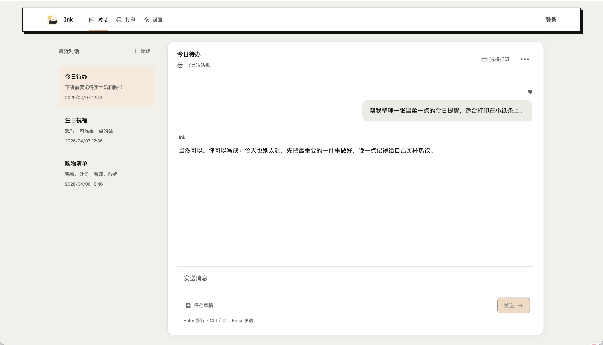

<p align="center">
  
</p>

<h1 align="center">Ink</h1>

<p align="center">
  A self-hosted workspace for turning notes into thermal-printer slips on a Memobird.
</p>

<p align="center">
  <a href="LICENSE"></a>
  <a href="https://github.com/ruhuang2001/Ink/actions/workflows/web-quality.yml"></a>
  <a href="https://github.com/ruhuang2001/Ink/actions/workflows/server-quality.yml"></a>
</p>

<p align="center">
  
</p>

Ink is a small web app you run yourself. You draft a note in a chat-style editor, ask an
AI assistant to tighten the wording, and send the result to a Memobird thermal printer as a
384px-wide slip. Everything — accounts, drafts, conversations, printer bindings and print
history — stays in your own PostgreSQL database.

It is built for the everyday case: a reminder on the desk, a note left for someone,
a short checklist, a line of encouragement. Not a document pipeline.

## Features

- **Chat-style drafting.** Keep a list of conversations, refine each one turn by turn,
  and print a single message or the whole thread.
- **Direct printing.** Skip the conversation and create a slip by hand when the text is
  already settled.
- **One renderer for preview and paper.** Previews are generated by the same
  384px-wide PNG pipeline that produces the physical job, so what you see is what prints.
- **Bring your own AI provider.** Any OpenAI-compatible endpoint works. An admin sets the
  base URL, model and API key in Settings; the key is encrypted before it is stored.
- **Multiple devices.** Bind more than one Memobird, pick a default, and see the status
  and history of every job.
- **Background status sync.** A server-side worker polls the printer so job state updates
  without an open browser tab.
- **Draft safety.** Workspace saves compare revisions atomically; an outdated save
  returns a conflict instead of quietly overwriting newer content.
- **Chinese and English UI**, light and dark themes, and a layout that adapts down to
  phone width.
- **Installable.** Add Ink to a phone home screen with the bundled web manifest; a
  service worker caches the app shell so it still opens when the network is down.

## How it works

```text
Browser
  │ HTTPS / JSON
  ▼
Vue web app ──────────► Go HTTP API ──────► OpenAI-compatible provider
                          │
                          ├──── PostgreSQL (users, drafts, devices, jobs)
                          └──── Memobird API (384px PNG, job status)
```

The frontend and API deploy separately and talk over versioned `/api/v1/...` endpoints.
The API owns authentication, persistence, PNG rendering and all provider calls.

## Quick start

Requirements: **Node.js 22**, **pnpm 10**, **Go 1.26.10+** and **Docker** (for the
PostgreSQL 16 development container). A Memobird Open Platform access key is needed only
for physical printing; everything else runs without one.

```bash
git clone https://github.com/ruhuang2001/Ink.git
cd Ink
pnpm install && pnpm --dir web install
```

Then start the two halves in separate terminals:

```bash
make dev-api    # PostgreSQL, migrations, seed account, API on :8080
make dev-web    # Vite dev server on :5173
```

`make dev-api` creates `server/.env` from the template on first run and writes the seeded
`admin` password to `server/.dev-admin-password`. Keep that file private.

Open <http://localhost:5173>, sign in, bind a device, and print your first slip. The in-app
guide under **Settings → Guide** walks through the same steps.

## Configuration

Production settings live in `server/.env`; start from
[`server/.env.example`](server/.env.example). The ones you should not leave default:

| Variable | Purpose |
| --- | --- |
| `DATABASE_URL` | PostgreSQL connection string |
| `JWT_SECRET` | Access-token signing secret |
| `AI_CONFIG_ENCRYPTION_KEY` | Encrypts stored AI provider credentials |
| `MEMOBIRD_ACCESS_KEY` | Memobird Open Platform access key |
| `TRUSTED_PROXY_CIDRS` / `TRUSTED_PROXY_HEADER` | Only when running behind a reverse proxy |

Full instructions — reverse proxies, HTTPS, backups, database operations and upgrade
notes — are in the [self-hosting guide](docs/SELF_HOSTING.md).

## Development

```bash
make check-web          # lint, format check, tests, build, performance budget
make check-api          # gofmt, tests, build
make smoke-api          # end-to-end API smoke flow against a throwaway PostgreSQL
make check-local-ci     # web and server CI jobs locally via act, plus the smoke test
```

Package layout and conventions are in [CONTRIBUTING.md](CONTRIBUTING.md); the component
and data-flow breakdown is in [docs/ARCHITECTURE.md](docs/ARCHITECTURE.md).

## Documentation

- [Self-hosting guide](docs/SELF_HOSTING.md)
- [Architecture](docs/ARCHITECTURE.md)
- [Workspace synchronization API](docs/WORKSPACE_API.md)
- [Print API and content limits](docs/PRINT_API.md)
- [Backup and restore verification](docs/BACKUP_RESTORE.md)
- [Maintenance scope and stability checklist](docs/MAINTENANCE.md)
- [Server reference](server/README.md) · [Frontend reference](web/README.md)

## Security

- The browser stores access and refresh session tokens in Web Storage. Deploy Ink behind
  HTTPS with a restrictive Content Security Policy, and treat XSS as a session-compromise
  risk until cookie-based refresh sessions land.
- Never commit `.env`, `.dev-admin-password`, Memobird access keys, device identifiers or
  database backups.
- Report vulnerabilities privately per [SECURITY.md](SECURITY.md), not in a public issue.

## Contributing

Issues and pull requests are welcome. Bug fixes, documentation and focused tests can go
straight to a PR; open an issue first for new features or larger refactors so the direction
stays consistent. See [CONTRIBUTING.md](CONTRIBUTING.md).

## License

[MIT](LICENSE)
